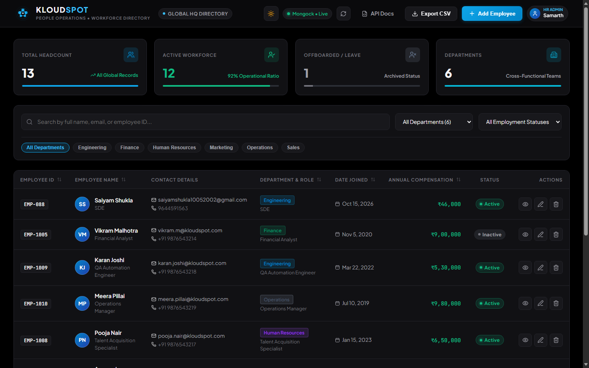
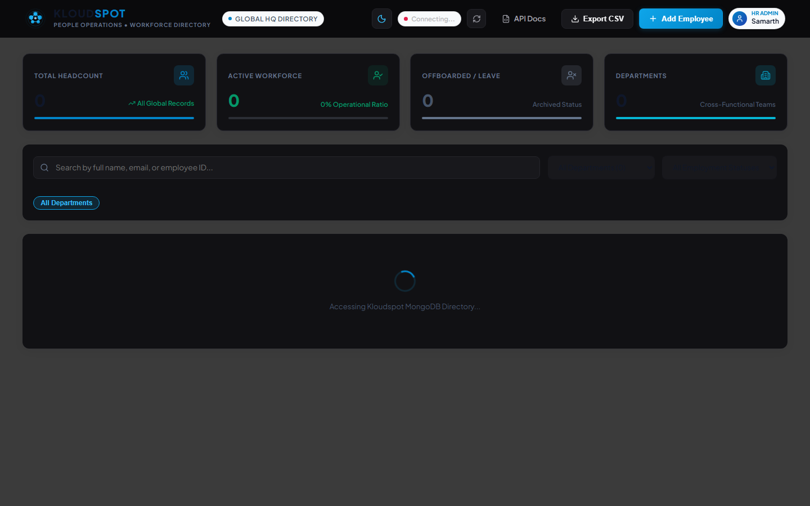
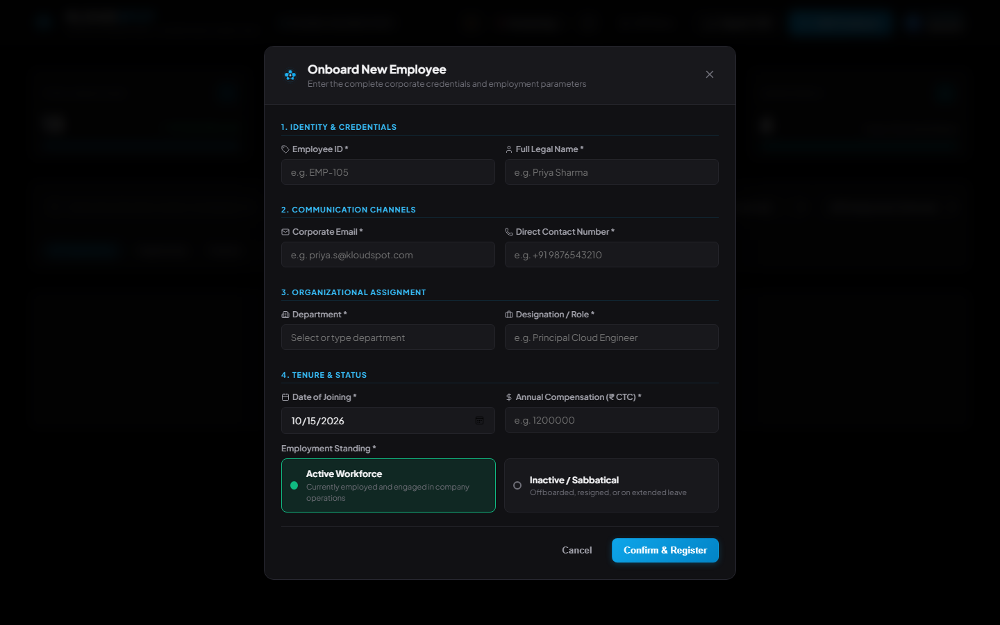
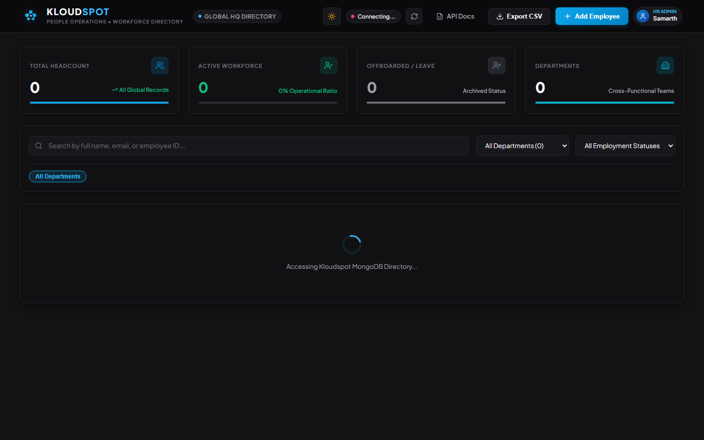
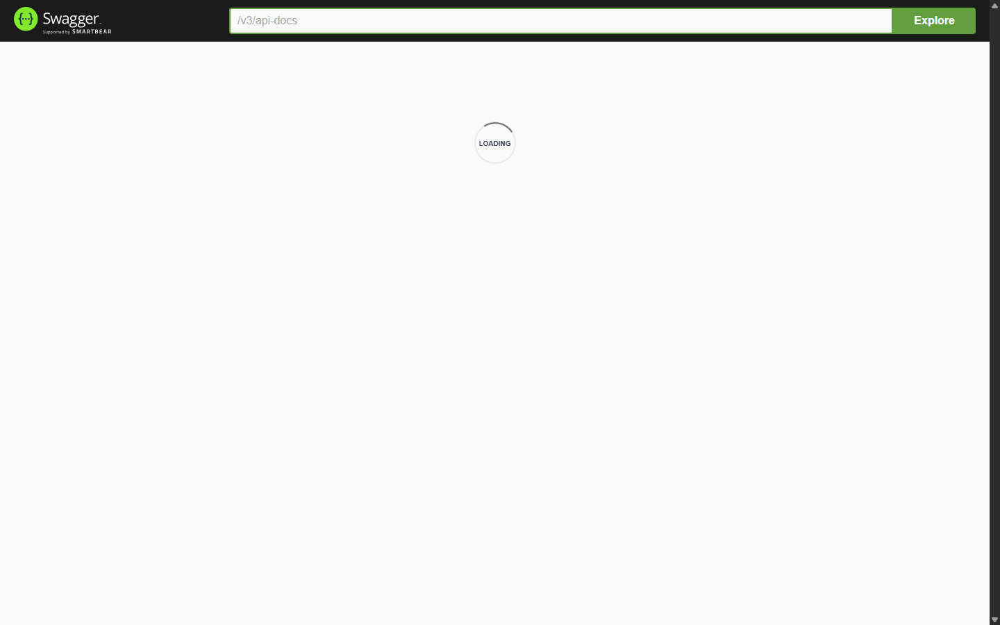

# Kloudspot | Technical Assessment
## Project 1: Employee Management System (Full Stack)

[](https://adoptium.net/)
[](https://spring.io/projects/spring-boot)
[](https://www.mongodb.com/)
[](https://react.dev/)
[](http://localhost:8080/swagger-ui.html)
[]()

> Developed for the **Software Engineer / Backend (Freshers)** Technical Assessment at **Kloudspot India Private Limited**.

---

## 1. System Overview

A full-stack, enterprise-grade Employee Management System allowing administrators to seamlessly manage employee records through an intuitive, modern dashboard backed by high-performance Spring Boot RESTful APIs and MongoDB persistent storage.

### Key Features Implemented:
* **Full CRUD Operations:** Add employee, view detailed profiles, edit details, and delete records with safety confirmation prompts.
* **All 9 Required Attributes Stored:** `Employee ID`, `Full Name`, `Email Address`, `Phone Number`, `Department`, `Designation`, `Date of Joining`, `Salary`, and `Employment Status (Active/Inactive)`.
* **Search & Multi-Filter:** Real-time search across Employee Name, Email, and ID, combined with simultaneous filtering by Department and Employment Status.
* **Server-Side Pagination & Sorting:** Efficient database pagination (`Pageable` with `skip()`/`limit()`) and dynamic field sorting.
* **Mongock Database Migration & Automated Seeding:** Enterprise version-controlled Mongock ChangeUnits (`V001__CreateEmployeeIndexes` and `V002__SeedInitialEmployees`) establishing unique indexes on `email` and `employeeId` with distributed locking and seeding 12 realistic records.
* **Dual-Theme Design System:** Instant switching between True Black Dark mode and crisp Executive Day (Light) mode with zero layout shift.
* **Interactive API Documentation:** Live Swagger / OpenAPI 3 UI available at `http://localhost:8080/swagger-ui.html`.
* **Unit Testing:** 23 comprehensive tests covering service-layer business logic and controller HTTP contracts using **JUnit 5** and **Mockito** (100% passing).
* **Bonus Enhancements Included:**
  * **Export to CSV:** One-click download of filtered employee lists into an RFC-4180 compliant CSV format with formula injection protection.
  * **Docker Compose:** Complete one-command containerization (`docker-compose.yml`) running MongoDB, Spring Boot Backend, and React Frontend with healthchecks.

---

## 2. Architecture & Design

```
[Browser / React 18 + Vite SPA]
        │
        │ HTTP REST (JSON) / Reverse Proxy
        ▼
[EmployeeController (REST Endpoints & Validation)]
        │
        ▼
[EmployeeService (Business Logic, Normalization & Conflict Prevention)]
        │
        ▼
[EmployeeRepository (Spring Data MongoDB & Dynamic Criteria Queries)]
        │
        ▼
[MongoDB 8.0 (Persistent Storage with Unique Indexes on email & employeeId)]
```

### Layered Architecture:
* **Controller Layer:** Exposes versioned REST endpoints, enforces HTTP status conventions (`200 OK`, `201 Created`, `400 Bad Request`, `404 Not Found`, `409 Conflict`), and handles CORS and file streaming.
* **Service Layer:** Encapsulates business logic, normalizes input strings (trimming, uppercase IDs, lowercase emails), validates duplicate constraints, and builds dynamic criteria queries via `MongoTemplate`.
* **Repository Layer:** Extends `MongoRepository<Employee, String>` for high-throughput queries.
* **Global Exception Handler:** Centralized `@RestControllerAdvice` catching validation errors, malformed JSON (`HttpMessageNotReadableException`), and database conflicts (`DuplicateKeyException`), returning standardized JSON error payloads.
* **Mongock Migration Engine:** Version-controlled `@ChangeUnit` migrations with distributed locking (`mongockChangeLog`), guaranteeing safe, idempotent index management and initial employee data seeding.

---

## 3. Technology Stack & Verified Versions

* **Backend:** Java 17.0.20.1 (Eclipse Temurin), Spring Boot 3.3.4, Apache Maven 3.9.9, Spring Data MongoDB, Lombok, Bean Validation.
* **Database:** MongoDB 8.0+ (NoSQL document store, container image `mongo:7.0`).
* **Migrations:** Mongock 5.5.1 with distributed locking driver.
* **Documentation & Testing:** SpringDoc OpenAPI 2.6.0 / Swagger UI, JUnit 5, Mockito.
* **Frontend:** React 18 / 19, Vite 5 / 8, Lucide React Icons, Modern Vanilla CSS Design Tokens.
* **Containerization:** Docker & Docker Compose (Multi-stage build, Nginx reverse proxy).

---

## 4. Quick Start (Running Locally)

### Option A: Running with Docker Compose (Single Command)
Ensure Docker Desktop is running, then run from the project root:

```bash
docker compose up --build
```

Access the applications:
* **Frontend Web Dashboard:** `http://localhost:3000`
* **Backend REST API:** `http://localhost:8080/api/employees`
* **Interactive Swagger UI:** `http://localhost:8080/swagger-ui.html`

> **Note on Port Conflicts:** Docker Compose maps host ports `27017` (MongoDB) and `8080` (Backend). If you are already running local standalone instances of `mongod` or Spring Boot on your host, stop them before running `docker compose up` to avoid host port collisions.

---

### Option B: Running Without Docker (Direct Local Execution)

#### 1. Start MongoDB
Ensure MongoDB is running on `localhost:27017`:
```powershell
mongod --dbpath "E:\mongodb\data"
```

#### 2. Run Backend (Spring Boot with Maven Wrapper)
In a new terminal:
```powershell
cd backend
.\mvnw.cmd spring-boot:run
```
* The backend will start on port `8080`.
* The database migration will automatically run and seed 12 sample employees.
* Verify Swagger UI at: `http://localhost:8080/swagger-ui.html`.

#### 3. Run Frontend (React + Vite)
In another terminal:
```powershell
cd frontend
npm install
npm run dev
```
* Open your browser at: `http://localhost:5173`.
* Vite dev server automatically proxies `/api` calls to `http://localhost:8080`.

---

## 5. Automated Unit Tests

Run the full automated test suite using the included Maven wrapper:

```powershell
cd backend
.\mvnw.cmd test
```

### Test Results: 28 Tests Executed, 0 Failures, 0 Errors (100% Passed)

#### Service-Layer Business Logic (`EmployeeServiceTest` - 15 Tests):
* `createEmployee_Success`: Verifies successful creation of valid employee.
* `createEmployee_DuplicateEmployeeId_ThrowsException`: Enforces uniqueness on Employee ID.
* `createEmployee_DuplicateEmail_ThrowsException`: Enforces uniqueness on Email.
* `getEmployeeById_Success`: Fetches record when ID exists.
* `getEmployeeById_NotFound_ThrowsException`: Returns 404 exception when ID is missing.
* `updateEmployee_Success`: Tests salary and role updates.
* `updateEmployee_NotFound_ThrowsException`: Verifies update failure for invalid IDs.
* `updateEmployee_DuplicateEmployeeId_ThrowsException`: Prevents assigning another record's ID during update.
* `updateEmployee_DuplicateEmail_ThrowsException`: Prevents assigning another record's email during update.
* `deleteEmployee_Success`: Validates deletion logic.
* `deleteEmployee_NotFound_ThrowsException`: Verifies deletion failure for non-existent IDs.
* `getAllEmployees_WithPagination`: Tests `Pageable` and multi-criteria query construction.
* `getAllEmployees_WithSearchAndFilter`: Tests combined search and department/status filtering.
* `getAllEmployeesForExport_Success`: Validates unpaginated dataset retrieval for CSV generation.
* `getEmployeeStats_Success`: Validates calculation of Total, Active, and Inactive KPI counts.

#### Authentication & Security Layer (`AuthControllerTest` - 4 Tests):
1. `login_AdminSuccess`: Verifies HR Administrator login, `ROLE_ADMIN` authority and Basic Auth token generation.
2. `login_EmployeeSuccess`: Verifies employee login using `employeeId` / `testing@123` and `ROLE_EMPLOYEE` profile.
3. `login_InvalidCredentials_Returns401`: Verifies `401 Unauthorized` response on incorrect password.
4. `logout_Returns200`: Verifies Spring Security context teardown and session invalidation.

#### HTTP Controller Layer (`EmployeeControllerTest` - 9 Tests):
Includes test for bulk CSV upload parsing (`importEmployeesFromCsv_Success`).

* `getAllEmployees_Returns200WithPagination`: Verifies `GET /api/employees` pagination JSON envelope.
* `createEmployee_ValidPayload_Returns201`: Verifies `POST /api/employees` returns HTTP 201 Created.
* `createEmployee_MissingRequiredFields_Returns400`: Verifies validation constraints trigger HTTP 400 with field errors.
* `createEmployee_EmptyBody_Returns400`: Verifies missing/empty JSON body triggers HTTP 400 Bad Request.
* `createEmployee_DuplicateConflict_Returns409`: Verifies duplicate resource triggers HTTP 409 Conflict.
* `getEmployeeById_NotFound_Returns404`: Verifies non-existent ID triggers HTTP 404 Not Found.
* `deleteEmployee_Returns200WithEnvelope`: Verifies `DELETE` returns HTTP 200 with standard `ApiResponse` envelope.
* `exportToCsv_ReturnsCsvFile`: Verifies CSV streaming with attachment header and column structure.

---

## 6. REST API Reference

### Spring Security & Authentication (Assessment Bonus Feature)

The system incorporates **Spring Security** with state-of-the-art HTTP Basic Authentication and role-based access control (`ROLE_ADMIN`, `ROLE_EMPLOYEE`).

#### Test Accounts & Credentials:
| Account Type | Username / Identifier | Password | Granted Role | Permissions |
| :--- | :--- | :--- | :--- | :--- |
| **HR Administrator** | `admin` (or `samarth` / `samarth@kloudspot.com`) | `samarthgunjal` | `ROLE_ADMIN` | Full directory CRUD, CSV Import, CSV Export |
| **Any Seeded Employee** | `<EmployeeID>` (e.g. `EMP-1001`) | `testing@123` | `ROLE_EMPLOYEE` | Directory Search, View Details, CSV Export |
| **Email Login** | `<Email>` (e.g. `aarav.sharma@kloudspot.com`) | `testing@123` | `ROLE_EMPLOYEE` | Directory Search, View Details, CSV Export |

*Every employee seeded or imported into MongoDB can authenticate seamlessly using their Employee ID or Email.*

---

### CSV Bulk Import & Export (RFC-4180 Compliant)

| Method | Endpoint | Description |
| :--- | :--- | :--- |
| `POST` | `/api/employees/import/csv` | Bulk imports employee records from an RFC-4180 CSV file (with duplicate prevention & upsert) |
| `GET` | `/api/employees/export/csv` | Streams filtered employee directory data as a downloadable RFC-4180 CSV attachment |


All JSON endpoints return a standardized envelope:
```json
{
  "success": true,
  "message": "Operation completed successfully",
  "data": { ... }
}
```

| Method | Endpoint | Description | Status Code |
| :--- | :--- | :--- | :--- |
| `POST` | `/api/employees` | Create a new employee (validates unique ID and email) | `201 Created` |
| `GET` | `/api/employees` | List employees (paginated, search across Name/Email/ID, multi-filter) | `200 OK` |
| `GET` | `/api/employees/{id}` | Get employee dossier by database ID | `200 OK` |
| `PUT` | `/api/employees/{id}` | Update employee details (conflict-checked) | `200 OK` |
| `DELETE`| `/api/employees/{id}` | Delete employee record with confirmation | `200 OK` |
| `GET` | `/api/employees/departments` | Get list of distinct company departments | `200 OK` |
| `GET` | `/api/employees/stats` | Get employee summary counts (Total, Active, Inactive) | `200 OK` |
| `GET` | `/api/employees/export/csv` | Export filtered employee records to RFC-4180 CSV | `200 OK (text/csv)` |

---

## 7. Application Screenshots

Genuine captures of the application running live from the verified source code:

| View | Screenshot |
| :--- | :--- |
| **Employee Directory (True Black Dark Mode)** |  |
| **Employee Directory (Executive Light Mode)** |  |
| **Add Employee Form Modal** |  |
| **Employee Details Dossier View** |  |
| **Edit Employee Information Modal** |  |
| **Interactive Swagger / OpenAPI Documentation** |  |

---

## 8. Postman Collection

A pre-configured Postman collection file is included in the project root:
* **File:** `postman_collection.json`
* **How to use:** Open Postman -> Click **Import** -> Select `postman_collection.json`.
* Contains 10 ready-to-run API requests with environment variable `{{EMPLOYEE_DB_ID}}` and example payloads.

---

## 9. Assessment Submission Details

* **Candidate Name:** Samarth
* **GitHub Username:** `Rartg`
* **Role:** Software Engineer / Backend (Freshers)
* **Company:** Kloudspot India Private Limited
* **Submission Recipients:** `manjunatha.v@kloudspot.com`, CC: `hr.team@kloudspot.com`
